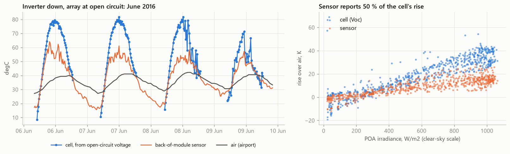
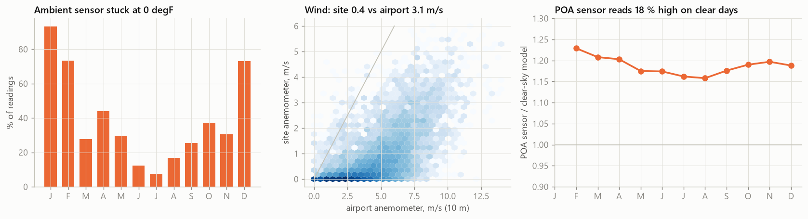
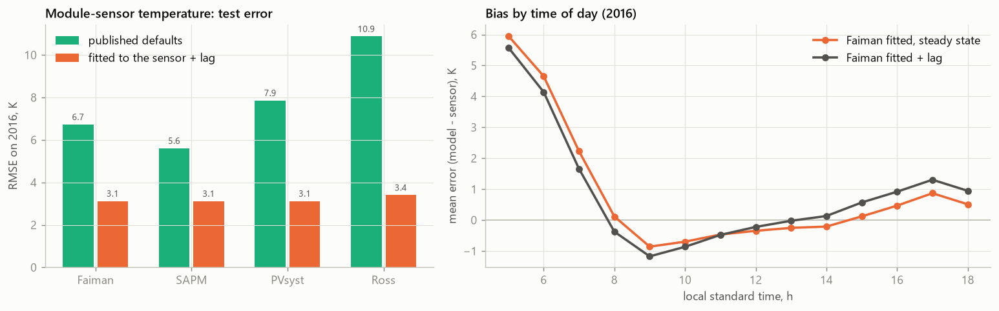
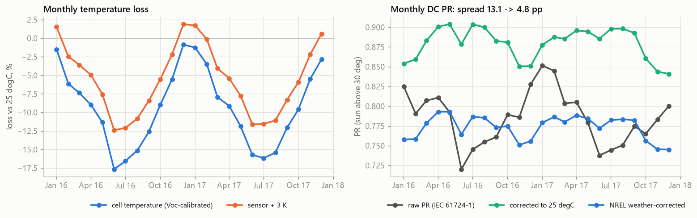
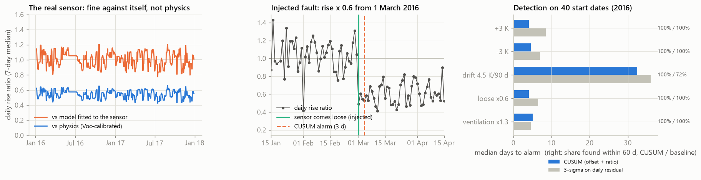
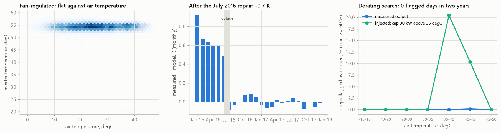
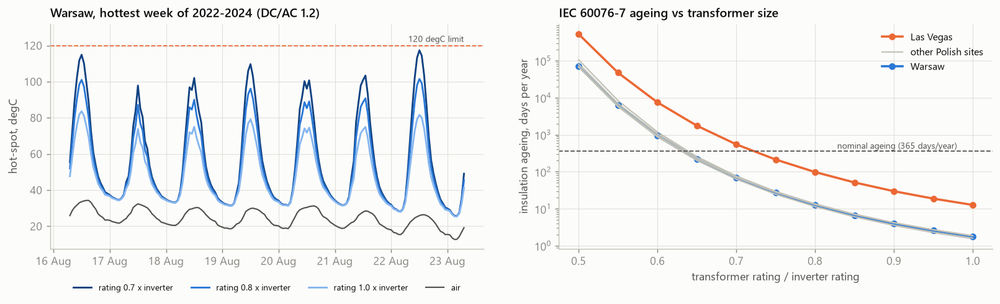
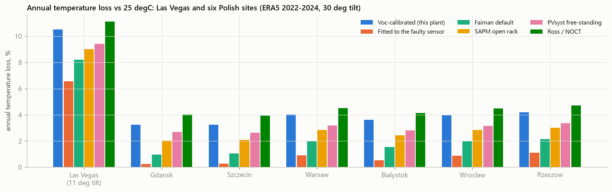

# PV thermal check: module, inverter and transformer temperatures on open data


Temperature is the most measured and least checked quantity in a PV plant. Monthly O&M reports correct the
performance ratio with a back-of-module sensor, design studies pick thermal coefficients from a table, and
inverters and transformers are assumed to stay cool enough. This project checks all of that on two years of a real
plant: **NREL PVDAQ system 34**, a 147 kWp rooftop array in Las Vegas (611 Sharp NU-U240F1 modules at 11° tilt,
one 135 kW central inverter, 15-minute data for 2016-2017).

It fits the four common module temperature models (Faiman, SAPM, PVsyst, Ross) with and without thermal inertia,
**verifies the module sensor itself against the cells' open-circuit voltage**, computes temperature losses and a
temperature-corrected PR, detects sensor faults from the model residual (validated on faults injected into the real
record), models the inverter's temperature and searches for thermal derating, sizes the step-up transformer with
the IEC 60076-7 thermal model, and transfers the fitted physics to six Polish sites with ERA5 weather.

Interactive dashboard: **https://kwwaleszczynski-del.github.io/pv-thermal-check/**



*During a 12-day inverter outage the array sat at open circuit, and the DC voltage channel recorded the string
open-circuit voltage. Converted to cell temperature (blue) it shows the cells running about 19 K hotter than the
back-of-module sensor (orange) in full sun: the sensor sees about half of the real heating.*

## Key results

| Question | Answer (PVDAQ 34, 2016-2017) |
|---|---|
| Can the back-of-module sensor be trusted? | **No.** Open-circuit-voltage thermometry puts the cells **19 K** above the sensor at > 800 W/m² (rise over air: cells 34 K, sensor 15 K); the sensor reports **50 %** of the heating. |
| Best module model on the sensor (test year) | SAPM / Faiman / PVsyst fitted + 14-min lag, **RMSE 3.1 K** (published defaults: 5.6-10.9 K, biased +4 to +9 K) |
| Physical coefficients (from the cells) | PVsyst **U<sub>c</sub> = 21.3, U<sub>v</sub> = 1.35** W/m²K; Faiman at maximum power point U<sub>0</sub> = 28.3, U<sub>1</sub> = 1.8 |
| Annual temperature loss vs 25 °C | **10.5-10.8 %** (cells); the sensor would say 6.6-6.8 %; worst month 17.7 % |
| Seasonal swing of monthly DC PR | **13.1 pp** raw → 6.3 pp corrected to 25 °C (IEC 61724-1) → **4.8 pp** NREL weather-corrected |
| Sensor faults injected into the real record | ±3 K step and loose sensor found in **4 days** (median), drift 4.5 K/90 d in 32 days, all 40 start dates each; one alarm in the clean test year |
| Inverter | Fan-regulated heatsink at 52-57 °C regardless of air temperature; **0.7 K cooler after the July 2016 repair**; **no thermal derating** up to 46.7 °C air |
| Step-up transformer (IEC 60076-7, DC/AC 1.2) | can be **0.75 ×** the inverter rating at all six Polish sites (0.85 × in Las Vegas); the hot-spot limit binds, not ageing |
| Poland (ERA5 2022-2024) | annual temperature loss **3.2-4.2 %** with this plant's coefficients; published models disagree by **2.7 pp** on average |

## Data

| Source | What | Licence |
|---|---|---|
| [NREL PVDAQ](https://doi.org/10.25984/1846021) system 34 | 15-min AC/DC power, DC voltage and current, POA irradiance, module, ambient and inverter temperature, wind, inverter error code | CC BY 4.0 |
| [NOAA ISD-Lite](https://www.ncei.noaa.gov/products/land-based-station/integrated-surface-database), Las Vegas airport (KLAS), 14 km from the plant | hourly 2 m air temperature and 10 m wind | US public domain |
| [ERA5](https://cds.climate.copernicus.eu/) via the [Open-Meteo](https://open-meteo.com/) archive API | hourly GHI/DNI/DHI, 2 m temperature, 10 m wind for six Polish sites, 2022-2024 | CC BY 4.0 |
| pvlib's CEC module database | Sharp NU-U240F1 single-diode parameters and datasheet Voc temperature coefficient | BSD-3 |

Everything is downloaded once into `data/` (git-ignored, about 16 MB). PVDAQ units are converted on load (°F → °C,
mph → m/s, hectowatt → kW, local standard time UTC-8 → UTC).

## 1. What the site sensors say



Before fitting anything, every channel was compared with an independent reference:

- **Ambient temperature:** 39 % of all readings are exactly 0 °F (93 % in January, 8 % in July); another 2.5 % are
  more than 8 K away from the airport. Where it works it agrees with the airport within 2.5 K (+0.8 K by day,
  −2.7 K at night on the roof).
- **Wind:** the site anemometer averages 0.4 m/s against 3.1 m/s at the airport (hourly correlation 0.70) and the
  wind vane does not move (interquartile range 0.6°). It is sheltered or seized.
- **POA irradiance:** on 212 clear days (pvlib's clear-sky detector) the sensor reads **18 % above** the Ineichen
  clear-sky model, 16-23 % depending on the month. The DC performance ratio at high irradiance would otherwise be
  0.65, implausibly low.

So the analysis uses the airport's 2 m air temperature and 10 m wind (the same heights as reanalysis, which matters
for the transfer to Poland) and divides the POA reading by 1.176. The clear-sky model itself is uncertain by a few
percent, and every U-value below scales with that factor.

## 2. Module temperature models

Steady-state models (pvlib), with POA irradiance $`G`$, air temperature $`T_a`$ and wind speed $`v`$:

```math
\begin{aligned}
\text{Faiman:}\quad & T_m = T_a + \frac{G}{U_0 + U_1 v} \\
\text{SAPM:}\quad & T_m = T_a + G\, e^{a + b v} \\
\text{PVsyst:}\quad & T_c = T_a + \frac{\alpha\, G\, (1 - \eta)}{U_c + U_v v} \\
\text{Ross:}\quad & T_c = T_a + k\, G
\end{aligned}
```

Thermal inertia is added in two ways: a first-order lag of the steady-state value with a fitted time constant
$`\tau`$ (exact zero-order-hold discretisation),

```math
T_k = T_{k-1} + \left(1 - e^{-\Delta t/\tau}\right)\left(T^{ss}_k - T_{k-1}\right),
```

and pvlib's transient model of Prilliman et al. (2020), which weights the previous 20 minutes by module mass and wind.
Coefficients are fitted by robust least squares on 2017 and scored on 2016, on operating daylight steps
(POA > 50 W/m², 13 747 test steps).



| Model | Published default RMSE / bias [K] | Fitted RMSE [K] | Fitted + lag RMSE [K] | Fitted coefficients |
|---|---|---|---|---|
| Faiman | 6.73 / +4.85 | 3.21 | 3.12 | U<sub>0</sub> = 55.4, U<sub>1</sub> = 4.1 |
| SAPM | 5.61 / +4.42 | 3.21 | **3.12** | a = −4.03, b = −0.059 |
| PVsyst | 7.86 / +6.62 | 3.21 | 3.12 | U<sub>c</sub> = 42.5, U<sub>v</sub> = 3.2 |
| Ross | 10.88 / +9.49 | 3.45 | 3.40 | k = 0.0145 |

- Fitted, the three wind-aware models are interchangeable (identical errors to 0.01 K); Ross, without wind, is
  0.3 K worse.
- Inertia helps little at 15-minute resolution: a lag of about 14 minutes cuts the RMSE by 0.09 K, Prilliman by 0.05 K.
- What remains is time-of-day structure: every steady-state model is 4-6 K too warm at dawn. After a clear desert
  night the module starts below air temperature (radiative cooling to the sky), which none of these models knows.
- The fitted U-values are suspicious: U<sub>0</sub> = 55 W/m²K is about twice what a rooftop rack achieves. The
  models fit the sensor very well, so the question becomes whether the sensor reports the module's temperature.

## 3. Is the sensor right? Open-circuit voltage thermometry

From 4 to 16 June 2016 the inverter was down (error code 139 later) while the DC voltage channel kept logging.
At open circuit no current flows, so there is no wiring drop, and the string voltage is 13 × the module Voc, which
depends on cell temperature through the datasheet coefficient (−0.123 V/K per module) and only logarithmically on
irradiance. This is the idea behind the equivalent cell temperature of IEC 60904-5:

```math
V_{oc}(G, T_c) = s \cdot N_s \left[ V_{oc}^{\mathrm{CEC}}(G, 25\,^\circ\mathrm{C}) + \beta_{V_{oc}} (T_c - 25\,^\circ\mathrm{C}) \right]
```

$`V_{oc}^{\mathrm{CEC}}`$ is the CEC single-diode model of the module at 25 °C (it carries the irradiance
dependence), $`N_s = 13`$ modules in series, and $`s`$ one array-level scale factor taken at low irradiance
(50-200 W/m²), where cells and back-sheet must agree. The fitted scale is 0.993: the 6-year-old array is within
0.7 % of its datasheet voltage. Each open-circuit step (684 steps on 24 days) is then inverted for $`T_c`$.

| POA [W/m²] | Steps | Cell − sensor [K] | Sensor rise over air [K] | Cell rise over air [K] |
|---|---|---|---|---|
| 20-200 | 129 | −0.3 | −0.3 | −0.5 |
| 200-400 | 100 | 1.5 | 3.4 | 5.0 |
| 400-600 | 102 | 5.2 | 8.2 | 14.5 |
| 600-800 | 102 | 11.2 | 11.6 | 25.3 |
| 800-1000 | 172 | 19.2 | 14.8 | 33.7 |
| 1000-1400 | 79 | 18.3 | 15.2 | 37.7 |

The sensor agrees with the cells at low light and reports about **half of the heating** (least-squares share 0.50
after allowing the usual 3 K cell-to-back difference at 1000 W/m²). It also lags: a 14-minute time constant against
8 minutes for the cells. That is the signature of a sensor that has partly lost thermal contact with the back-sheet.
Using the CEC model's own temperature dependence instead of the datasheet coefficient (its Voc falls 13 % faster
with temperature) gives 14.6 K instead of 19 K. The conclusion stands either way.

Fitted to the cells (PVsyst with $`\eta = 0`$ at open circuit): **U<sub>c</sub> = 21.3, U<sub>v</sub> = 1.35**
W/m²K, between PVsyst's "semi-integrated" (20) and "free-standing" (29) defaults, which is plausible for a
low-tilt rooftop rack. In Faiman form at the maximum power point (the absorbed light minus what becomes
electricity): U<sub>0</sub> = 28.3, U<sub>1</sub> = 1.8. These are the coefficients used for energy and for Poland.
The open-circuit window is 12 days in June, so the wind term is weakly constrained.

## 4. Temperature losses and performance ratio

The irradiance-weighted temperature loss against 25 °C, with the module's power coefficient
$`\gamma = -0.458\ \%/\mathrm{K}`$:

```math
L_T = \frac{\sum_k G_k\, \gamma\, (T_{c,k} - 25\,^\circ\mathrm{C})}{\sum_k G_k}
```

Three PR definitions on the DC side (to keep inverter clipping and the June 2016 outage out):

```math
\mathrm{PR} = \frac{\sum P_{dc}}{\sum P_{STC}\, G/G_{STC}}, \qquad
\mathrm{PR}_{25} = \frac{\sum P_{dc}}{\sum P_{STC}\, \frac{G}{G_{STC}} \left[1 + \gamma (T_c - 25\,^\circ\mathrm{C})\right]}, \qquad
\mathrm{PR}_{\mathrm{NREL}} = \frac{\sum P_{dc}}{\sum P_{STC}\, \frac{G}{G_{STC}} \left[1 + \gamma (T_c - \bar T_c)\right]}
```

$`\mathrm{PR}_{25}`$ is the IEC 61724-1 temperature-corrected PR; $`\mathrm{PR}_{\mathrm{NREL}}`$ (Dierauf et al.
2013) corrects to the plant's irradiance-weighted annual mean cell temperature $`\bar T_c`$ (51.7 °C here), so its
level stays comparable with the raw PR.



- **Annual temperature loss: 10.8 % (2016) and 10.5 % (2017)**, from 1-3 % in winter to 15.7-17.7 % in June and
  July. With the faulty sensor (plus the usual 3 K) one would report 6.8 % and 6.6 %: a third of the loss would be
  booked as something else.
- **The correction removes the seasonal artefact** (operating steps, sun above 30° to keep the winter row shading
  out): the monthly spread drops from 13.1 pp to 6.3 pp (PR<sub>25</sub>) and 4.8 pp (PR<sub>NREL</sub>), and the
  correlation with cell temperature from −0.91 to +0.43.
- The faulty sensor corrects the season almost as well (4.8 pp), because the seasonal swing of cell temperature is
  mostly the swing of air temperature, which the sensor follows. It gets the level wrong, not the shape.
- What is left is a winter dip and an autumn decline. The first matches the inter-row shading found in
  [pv-shade-fingerprint](https://github.com/kwwaleszczynski-del/pv-shade-fingerprint) plus angle-of-incidence
  losses; the second is consistent with soiling during Las Vegas's dry autumn, but this was not tested.
- NREL's correction is first-order, so even on synthetic data with a perfect temperature model it leaves a small
  residual swing (see `tests/test_performance.py`). That is a property of the method, not of this plant.

## 5. Sensor fault detection

Each day, over operating steps with POA > 200 W/m², two features compare the sensor with the model (Faiman + lag,
fitted on the reference year):

```math
r_d = \overline{T_m - \hat T_m}, \qquad
q_d = \frac{\sum (T_m - T_a)}{\sum (\hat T_m - T_a)}
```

An offset or a drift moves the residual $`r_d`$; a sensor losing contact ($`q_d < 1`$) or a change in rear
ventilation ($`q_d > 1`$) moves the rise ratio. Both are standardised with the median and MAD of the reference year
(2017) and fed into two-sided CUSUM charts,

```math
S^{+}_d = \max\left(0,\ S^{+}_{d-1} + z_d - k\right), \qquad S^{-}_d = \max\left(0,\ S^{-}_{d-1} - z_d - k\right),
```

with $`k = 0.5`$, $`z`$ clipped at ±4 and the threshold $`h = 6.5`$ set so that the reference year gives at most one
alarm. After an alarm, the daily regression $`T_m - T_a = a + b\,(\hat T_m - T_a)`$ labels it: a change in $`b`$
means contact or ventilation, otherwise offset or drift. The baseline is a plain 3σ chart on the daily residual.

Faults were injected into the real 2016 sensor record at 40 weekly start dates (15 Jan - 15 Oct), with a 60-day
horizon:



| Injected fault | CUSUM found | Median / 90th pct. days | Label correct | 3σ baseline found | Baseline median days |
|---|---|---|---|---|---|
| step +3 K | 100 % | 4 / 11 | 98 % | 100 % | 8.5 |
| step −3 K | 100 % | 4.5 / 21 | 100 % | 100 % | 7 |
| drift +4.5 K per 90 days | 100 % | 32.5 / 39 | 98 % | 72 % | 36 |
| loose sensor, rise × 0.6 | 100 % | 4 / 13 | 98 % | 100 % | 6.5 |
| less ventilation, rise × 1.3 | 100 % | 5 / 13 | 52 % | 100 % | 4.5 |
| step +1 K | 70 % | 20.5 / 47 | 96 % | 45 % | 17.5 |
| step +2 K | 100 % | 7.5 / 18 | 95 % | 72 % | 14 |
| loose sensor, rise × 0.8 | 98 % | 9 / 30 | 38 % | 20 % | 30.5 |

- A drift is found when it has reached about 1.6 K. Less ventilation is found fast but half the time labelled as an
  offset: on a hot day both raise the residual.
- **False alarms:** none in the reference year by construction; in the clean 2016 test year, one, on 1 June. It
  followed a week of residuals 2-5 K above the model while the DC PR fell from 0.79 to 0.72, three days before the
  inverter failed. Without string-level data it cannot be tied to the failure, so it counts as a false alarm.
- **The real sensor:** against a model fitted to its own history it looks healthy (rise ratio around 1). Against the
  Voc-calibrated physics its daily rise ratio is **0.55 (median over 685 days, interquartile range 0.47-0.61)**, with
  no trend: it was already loose when the record starts. A detector learned from a sensor's own history can never find a fault the
  sensor always had; this needs an independent reference such as open-circuit voltage.

## 6. Inverter

The inverter temperature channel (integer °C) reads 52-57 °C whenever the unit runs, whatever the air temperature,
and 29-34 °C at night even in January (the unit stands in a conditioned room). A linear model on warm operating
steps of the year after the July 2016 repair:

```math
T_{inv} = 53.1 + 2.20\, \frac{P_{ac}}{P_{rated}} + 0.004\, T_a \qquad (\mathrm{RMSE}\ 0.85\ \mathrm{K})
```

The air term is zero: the cooling is regulated (variable fan speed), with the load adding about 2 K.



- **Before the June 2016 failure the inverter ran 0.7 K warmer** at the same load than after the repair. The CUSUM
  on the daily residual flags it from 4 January 2016 and keeps alarming (37 restarts) until 3 June, the day before
  the failure; after the repair it is quiet except for one alarm in March 2017. A warmer heatsink at the same load
  means more losses or less cooling, a plausible precursor, though one case proves nothing.
- **Injected cooling faults** on the second half of 2017 (16 start dates each): a fan problem adding 4 K at rated
  load and a +1.5 K step were both found in all cases, in 3 days median.
- **Thermal derating:** a step is flagged when AC power sits on a plateau more than 8 % below the expected output
  (DC model with a 30-day rolling calibration on part-load steps, times the median conversion efficiency). The real
  record has 3 flagged steps and **0 flagged days** in two years, up to 46.7 °C air. Conversion efficiency rises
  slightly with heat (0.938 → 0.947), and at the highest inverter temperatures (58-59 °C) output is 8-14 % above
  expectation. An injected cap (90 kW whenever the air exceeds 35 °C) is found on 72 % of the affected days with
  no false days (step precision 0.99).
- The expected-output model leaves a shortfall of about 2 % on hot afternoons, at low load as well as high, and a
  3-4 % surplus in cool mornings. A cap would act only at high load, so this is a morning-afternoon asymmetry of the
  model (thermal lag, angle of incidence, soiling), not derating.

## 7. Step-up transformer: IEC 60076-7 thermal model

No open dataset combines a PV plant with transformer oil temperatures, so this part is a model study. The loading
guide's thermal model for oil-immersed transformers gives top-oil and hot-spot temperatures from the per-unit load
$`K`$ and air temperature:

```math
\begin{aligned}
\frac{d\Delta\theta_o}{dt} &= \frac{1}{k_{11}\tau_o}\left[\left(\frac{1 + R K^2}{1 + R}\right)^{x}\Delta\theta_{or} - \Delta\theta_o\right] \\
\frac{d\Delta\theta_{h1}}{dt} &= \frac{1}{k_{22}\tau_w}\left[k_{21}\, \Delta\theta_{hr} K^{y} - \Delta\theta_{h1}\right], \qquad
\frac{d\Delta\theta_{h2}}{dt} = \frac{k_{22}}{\tau_o}\left[(k_{21} - 1)\, \Delta\theta_{hr} K^{y} - \Delta\theta_{h2}\right] \\
\theta_h &= \theta_a + \Delta\theta_o + \Delta\theta_{h1} - \Delta\theta_{h2}
\end{aligned}
```

and the relative ageing rate of non-thermally-upgraded paper, $`V = 2^{(\theta_h - 98)/6}`$ (1 at 98 °C). Parameters
are the guide's ONAN distribution-transformer exponents and time constants ($`x = 0.8`$, $`y = 1.6`$,
$`k_{11} = 1`$, $`k_{21} = 1`$, $`k_{22} = 2`$, $`\tau_o = 180`$ min, $`\tau_w = 4`$ min, $`R = 5`$) with rated
rises $`\Delta\theta_{or} = 52`$ K and $`\Delta\theta_{hr} = 26`$ K, so that the hot-spot sits at the 98 °C
reference at rated load and 20 °C air. The load is a PV plant with DC/AC 1.2, simulated with the Voc-calibrated
thermal model (measured POA in Las Vegas, ERA5 in Poland).



| Rating / inverter rating | Las Vegas: max hot-spot, ageing [days/yr] | Warsaw: max hot-spot, ageing [days/yr] |
|---|---|---|
| 1.00 | 99.6 °C, 13 | 88.0 °C, 1.8 |
| 0.85 | 114.8 °C, 51 | 103.3 °C, 6.7 |
| 0.80 | 122.3 °C, 98 | 110.7 °C, 13 |
| 0.75 | 131.1 °C, 214 | 119.4 °C, 27 |
| 0.70 | 141.7 °C, 551 | 129.7 °C, 69 |

- A PV transformer loaded to its inverter's rating ages at 0.5 % (Warsaw) to 3.5 % (Las Vegas) of the nominal
  rate: it is cold most of the day and all night.
- The smallest rating that keeps the hot-spot under 120 °C, the top oil under 105 °C, the load under 1.5 p.u. and
  the ageing at or below nominal is **0.75 × the inverter rating at all six Polish sites** and 0.85 × in Las Vegas.
- **The binding limit is the hot-spot on the hottest clear days, not ageing:** at 0.75 × Warsaw still uses only
  27 days of life per year.
- Generic parameters: a real unit's rated rises, time constants and losses come from its test report, and a
  kiosk enclosure adds several kelvin to the air temperature. Use this as a screening estimate, not a sizing rule.

## 8. Transfer to Poland

Hourly ERA5 (2022-2024) for six sites: coast (Gdańsk), west (Szczecin), centre (Warsaw), north-east (Białystok),
south-west (Wrocław) and south-east (Rzeszów). POA for a 30° south-facing array (Perez transposition, sun position
at mid-hour because ERA5 radiation is an hourly mean), cell temperature from each model, then $`L_T`$ as above.



| Site | POA [kWh/m²/yr] | Mean air [°C] | Voc-calibrated (this plant) | Fitted to the faulty sensor | Faiman default | SAPM open rack | PVsyst free-standing | Ross / NOCT |
|---|---|---|---|---|---|---|---|---|
| Las Vegas (11° tilt) | 2153 | 22.3 | 10.5 % | 6.6 % | 8.2 % | 9.0 % | 9.4 % | 11.1 % |
| Gdańsk | 1394 | 10.1 | 3.2 % | 0.2 % | 1.0 % | 2.0 % | 2.7 % | 4.0 % |
| Szczecin | 1358 | 10.6 | 3.2 % | 0.3 % | 1.1 % | 2.1 % | 2.6 % | 4.0 % |
| Warsaw | 1358 | 10.5 | 4.0 % | 0.9 % | 2.0 % | 2.9 % | 3.2 % | 4.5 % |
| Białystok | 1325 | 9.5 | 3.6 % | 0.5 % | 1.6 % | 2.4 % | 2.8 % | 4.1 % |
| Wrocław | 1411 | 11.3 | 4.0 % | 0.9 % | 2.0 % | 2.8 % | 3.1 % | 4.5 % |
| Rzeszów | 1392 | 11.1 | 4.2 % | 1.1 % | 2.1 % | 3.0 % | 3.4 % | 4.7 % |

- With this rooftop array's coefficients, Polish sites lose **3.2-4.2 %** per year to heat, a third of Las Vegas.
  The coast is coolest; the south-east and south-west lose most.
- **The models disagree by 2.7 pp on average** (published defaults and the Voc-calibrated fit), more than twice
  the 1.0 pp between the coolest and the warmest site. Ross with the datasheet NOCT is the most pessimistic.
- Faiman's defaults come out lowest because they were determined with wind measured near the modules; fed with
  10 m reanalysis wind they over-cool. SAPM's defaults expect 10 m wind.
- Coefficients fitted to the faulty sensor would claim 0.2-1.1 %: a bad sensor in a reference plant propagates
  straight into yield assessments.
- This is an illustration. The coefficients belong to one low-tilt rooftop rack in a desert; a ground-mounted
  array at 30° with more airflow beneath it, or a different module construction, has other coefficients (PVsyst's
  free-standing default gives 2.6-3.4 %).

## Limitations

- **One plant, two years.** The Voc thermometry rests on 24 days with open-circuit data, 12 of them in one June
  outage; its wind coefficient is weakly constrained and the result scales with the datasheet Voc coefficient
  (14.6 K instead of 19 K with the single-diode model's own).
- **Irradiance scale.** The POA sensor was rescaled to a clear-sky model (Ineichen with climatological turbidity),
  itself uncertain by a few percent; all U-values scale with it.
- **Station weather.** Air temperature and wind come from an airport 14 km away, not from the roof. This adds
  noise to every daily residual (1.6 K) and probably part of the dawn bias.
- **Injected faults are idealised:** clean steps, ramps and multiplicative changes. Real sensor failures can be
  intermittent; the detection delays are for this noise level and a one-false-alarm-per-year threshold.
- **The transformer is generic.** No measured PV-transformer temperatures were available; parameters come from
  the loading guide's typical values.
- **ERA5 for Poland** has known irradiance biases, and the Polish PV model is deliberately simple (fixed tilt, one
  loss factor, linear temperature coefficient).
- Not engineering, investment or legal advice.

## Run it

```bash
python -m venv .venv
.venv/Scripts/python -m pip install -e ".[dev]"     # Linux/macOS: .venv/bin/python
.venv/Scripts/python -m pytest -q                    # 36 tests, synthetic data, no network, ~1 min
.venv/Scripts/python -m pv_thermal run               # downloads (cached), analysis, figures, dashboard: ~1.5 min
```

`python -m pv_thermal fetch` only downloads. `--pvdaq-dir` points at an existing folder of PVDAQ daily files
(for example the one of [pv-anomaly-autoencoder](https://github.com/kwwaleszczynski-del/pv-anomaly-autoencoder)).
The ERA5 download is one Open-Meteo request of weight 235 (6 sites × 5 variables × 3 years).

| Path | Content |
|---|---|
| `src/pv_thermal/data.py` | PVDAQ, NOAA ISD-Lite and Open-Meteo/ERA5 loaders with unit conversion |
| `src/pv_thermal/qc.py` | stuck ambient values, wind check, POA scale against clear sky |
| `src/pv_thermal/thermal.py` | Faiman, SAPM, PVsyst, Ross; fitting, first-order lag, Prilliman |
| `src/pv_thermal/voc.py` | open-circuit voltage thermometry |
| `src/pv_thermal/performance.py` | temperature loss, raw / IEC / NREL PR |
| `src/pv_thermal/faults.py` | fault injection, daily features, CUSUM, labelling |
| `src/pv_thermal/inverter.py` | inverter temperature model, derating search |
| `src/pv_thermal/transformer.py` | IEC 60076-7 thermal model, ageing, sizing table |
| `src/pv_thermal/poland.py` | ERA5 fetch, transposition, simple PV model |
| `src/pv_thermal/analysis.py` | the study, section by section; writes `results/` |
| `results/` | `summary.json` and the CSV tables behind every number above |
| `docs/` | README figures and the GitHub Pages dashboard |

## Related projects

- [pv-anomaly-autoencoder](https://github.com/kwwaleszczynski-del/pv-anomaly-autoencoder): fault detection on the
  same PVDAQ system with an autoencoder; it caught the June 2016 inverter failure within half an hour.
- [pv-shade-fingerprint](https://github.com/kwwaleszczynski-del/pv-shade-fingerprint): shading from power data
  alone; it found the winter inter-row shading that remains in the corrected PR here.

## Sources

- Deline, C. et al. (2021). *Photovoltaic Data Acquisition (PVDAQ) Public Datasets.* NREL / OEDI.
  https://doi.org/10.25984/1846021 (CC BY 4.0).
- NOAA National Centers for Environmental Information, *Integrated Surface Database (ISD-Lite)*, station 723860-23169.
- Hersbach, H. et al. (2020). The ERA5 global reanalysis. *Q. J. R. Meteorol. Soc.* 146, 1999-2049; accessed via the
  Open-Meteo historical weather API (CC BY 4.0).
- Faiman, D. (2008). Assessing the outdoor operating temperature of photovoltaic modules. *Prog. Photovolt.* 16, 307-315.
- King, D. L., Boyson, W. E., Kratochvil, J. A. (2004). *Photovoltaic Array Performance Model.* SAND2004-3535.
- Prilliman, M. et al. (2020). Transient weighted moving-average model of photovoltaic module back-surface
  temperature. *IEEE J. Photovolt.* 10(4), 1053-1060.
- Dierauf, T. et al. (2013). *Weather-Corrected Performance Ratio.* NREL/TP-5200-57991.
- IEC 61724-1 (PV system performance monitoring), IEC 60904-5 (equivalent cell temperature by the open-circuit
  voltage method), IEC 60076-7 (loading guide for mineral-oil-immersed power transformers).
- Holmgren, W. F., Hansen, C. W., Mikofski, M. A. (2018). pvlib python. *J. Open Source Softw.* 3(29), 884.

## License

MIT, see [LICENSE](LICENSE).
